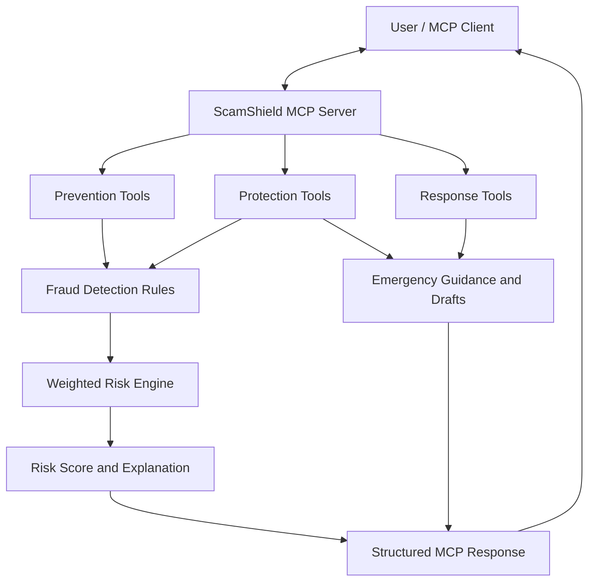

<div align="center">

# 🛡️ ScamShield

### Think Before You Pay. Act Before It's Too Late!

An MCP-powered toolkit that helps AI assistants detect scams, explain risks and guide victims through the first critical hour after fraud.


**wHACKiest 2026 • Track 1: Make MCP Matter**

[Problem](#-the-problem) • [Demo](#-demo) • [Features](#-features) • [Architecture](#-architecture) • [Quick Start](#-quick-start) • [Roadmap](#-roadmap)

</div>

---

## 💡 The Problem

Imagine receiving a message saying your bank account will be blocked unless you complete your KYC immediately.

Would you know whether it is genuine? And if you had already transferred money to a scammer, would you know what to do next?

Recognizing a scam and knowing how to respond are two different challenges. We wanted to bring both into one tool and explain **why** something is risky.

ScamShield focuses on three things:

- **Prevent:** Identify suspicious activity before making a payment.
- **Respond:** Guide victims through the immediate steps after financial fraud.
- **Protect:** Help users warn their family members.

### Who is it for?

- First-time UPI and digital payment users.
- Elderly people and their families.
- Anyone receiving suspicious KYC, digital arrest, refund or payment messages.

---

## 🎬 Demo


[](https://youtu.be/QYnCnlIhPIM)


Our working prototype currently runs through MCP Inspector.

| Scenario | Tool | Result |
|---|---|---|
| Digital arrest scam | `analyze_message` | 🟠 High Risk — 77/100 |
| Suspicious payment request | `before_you_pay` | 🟡 Medium Risk — 34/100 |
| ₹5,000 UPI fraud | `golden_hour_help` | Emergency response checklist |

### ScamShield in Action

**Suspicious message:**

> Your bank account will be blocked. Urgent KYC verification required. Share your OTP immediately or face digital arrest.

**Actual MVP result:**

| Parameter | Result |
|---|---|
| Risk score | 77/100 |
| Verdict | High Risk |
| Indicators detected | 4 |
| Reasons | Urgency, OTP, KYC, digital arrest |

**Recommended action:** Avoid suspicious links and payments. Verify the request independently through official channels.

### Golden Hour Mode

**Input:** ₹5,000 lost through UPI.

**Response summary:**

1. Contact your bank immediately.
2. Call the National Cybercrime Helpline — **1930**.
3. Report the incident at cybercrime.gov.in.
4. Preserve transaction evidence.
5. Secure compromised accounts.

<details>
<summary><b>Reproduce our demo results</b></summary>

### 1. analyze_message

```text
Your bank account will be blocked. Urgent KYC verification required. Share your OTP immediately or face digital arrest.
```

Expected result: 77/100 — High Risk.

### 2. before_you_pay

```text
Message: Send money urgently to claim your prize
URL: http://xn--example-abc.com/login
UPI ID: lotterywinner@unknown
Phone: 1234567890
```

Expected result: 34/100 — Medium Risk.

### 3. golden_hour_help

```text
Amount lost: 5000
Payment method: UPI
```

Expected result: Emergency response checklist.

Risk scores may change as the detection engine is improved.

</details>

---

## ⚡ Features

### 🔍 Prevent

| MCP Tool | Function |
|---|---|
| `analyze_message` | Detects common scam indicators and social engineering patterns |
| `check_url` | Analyzes suspicious URL structures |
| `check_upi` | Checks UPI ID formats and suspicious patterns |
| `check_phone` | Checks phone number formats and patterns |
| `before_you_pay` | Combines multiple payment safety checks |

### 🚨 Respond

| MCP Tool | Function |
|---|---|
| `golden_hour_help` | Provides immediate post-fraud guidance |
| `generate_bank_complaint` | Generates structured bank complaint drafts |
| `track_complaint` | Provides guidance based on user-entered complaint status |

### 🔐 Protect

| MCP Tool | Function |
|---|---|
| `family_guard_review` | Generates warning drafts for family members |
| `scamshield_security_audit` | Reports prototype capabilities and limitations |

---

## 🛡️ Safety by Design

A fraud prevention tool should never become another security risk.

| Action | Behavior |
|---|---|
| Risk analysis | Returns assessments without performing external actions |
| Complaint generation | Generates drafts only |
| Family warnings | Generates drafts only |
| Sensitive actions | Require manual user review |
| Financial transactions | Not supported |
| Credential requests | Not supported |

- No automatic payments.
- No requests for OTPs, PINs, CVVs or passwords.
- No automatic complaint submission.
- Users remain in control of further actions.

---

## 🏗️ Architecture



### Risk Detection Engine

Our risk engine calculates scores using weighted fraud indicators, confidence values and source reliability factors.

We have also developed a centralized signal registry and standalone fraud detector to make the system easier to extend and test.

Full integration of the centralized detector across all tools is currently in progress.

| Score | Risk Level |
|---|---|
| 0–29 | 🟢 Low Risk |
| 30–59 | 🟡 Medium Risk |
| 60–79 | 🟠 High Risk |
| 80–100 | 🔴 Critical Risk |

Risk scores are heuristic assessments, not verified probabilities of fraud.

---

## 🛠️ Tech Stack

| Technology | Purpose |
|---|---|
| TypeScript | Backend development |
| Node.js | Runtime environment |
| MCP SDK | Tool registration and communication |
| Zod | Input validation |
| MCP Inspector | Testing and demonstration |
| Git & GitHub | Version control |

---

## 📂 Project Structure

```text
ScamShield/
├── README.md
├── .gitignore
├── docs/
│   └── ScamShield_MVP_Demo.mp4
└── mcp-server/
    ├── package.json
    ├── package-lock.json
    ├── tsconfig.json
    └── src/
        ├── index.ts
        └── engines/
            ├── fraud/
            │   ├── fraud-detector.ts
            │   ├── fraud-detector.test.ts
            │   └── risk-engine.ts
            └── intelligence/
                └── signal-registry.ts
```

---

## 🚀 Quick Start

### Prerequisites

- Node.js
- npm
- Git

### 1. Clone the repository

```bash
git clone https://github.com/shashisaksham08-pixel/ScamShield.git
cd ScamShield/mcp-server
```

### 2. Install dependencies

```bash
npm install
```

### 3. Check TypeScript compilation

```bash
npx tsc --noEmit
```

### 4. Launch MCP Inspector

**Windows PowerShell:**

```powershell
npx.cmd -y @modelcontextprotocol/inspector node_modules/.bin/tsx.cmd src/index.ts
```

**macOS / Linux (not yet tested):**

```bash
npx -y @modelcontextprotocol/inspector node_modules/.bin/tsx src/index.ts
```

Open the local URL displayed in the terminal, connect to the server and explore the available tools.

### 5. Run standalone detector tests

```bash
npx tsx src/engines/fraud/fraud-detector.test.ts
```

Windows users facing PowerShell execution policy errors can use `npm.cmd` and `npx.cmd` instead.

---

## 📊 MVP Status

| Component | Status |
|---|---|
| Working MCP server | ✅ Completed |
| 10 registered MCP tools | ✅ Completed |
| Weighted risk engine | ✅ Completed |
| Centralized signal registry | ✅ Completed |
| TypeScript compilation | ✅ Passing |
| Manual testing of all 10 tools | ✅ Completed |
| Standalone detector test scenarios | ✅ Executed |
| Centralized detector integration | ⏳ In progress |
| Frontend interface | ⏳ Planned |
| Real-world accuracy evaluation | ⏳ Planned |

---

## 🗺️ Roadmap

- [ ] Complete centralized fraud detector integration
- [ ] Improve risk scoring consistency
- [ ] Interactive web and chat interface
- [ ] QR code analysis
- [ ] Verified fraud intelligence integration
- [ ] AI-assisted contextual analysis
- [ ] Authentication and secure data storage
- [ ] Automated testing and evaluation

---

## ⚠️ Current Limitations

ScamShield is currently a hackathon prototype.

- Fraud detection is rule-based.
- No live banking or UPI verification.
- No live phone reputation database.
- No automatic government complaint tracking.
- Risk scoring requires further calibration.
- A low risk score does not guarantee safety.

---

## 🇮🇳 Emergency Resources

In case of financial cyber fraud:

- **National Cybercrime Helpline:** 1930
- **Report online:** [cybercrime.gov.in](https://cybercrime.gov.in)
- Contact your bank through official channels immediately.

---

## Disclaimer

ScamShield provides preliminary fraud risk assessments and safety guidance. It does not guarantee detection accuracy or recovery of lost funds.

---

<div align="center">

# ScamShield

**Prevent. Respond. Protect.**

Built for wHACKiest 2026.

</div>
